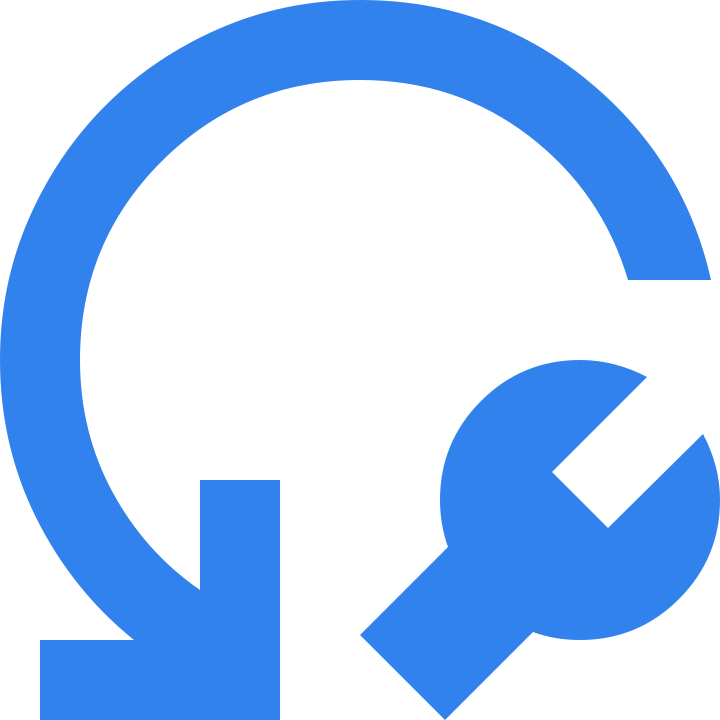

<div align="center">
    <h2>
         DDD Toolbox
    </h2>
</div>

<div align="center">
    <h3>
        A comprehensive collection of Domain-Driven Design tools to help you model complex business domains, facilitate collaborative workshops, and create shared understanding across your organization.
    </h3>
    <p>
        <a href="https://dddtoolbox.com/domain-storytelling">Try Domain Storytelling →</a>
        <br>
        <a href="https://dddtoolbox.com/event-storming">Try Event Storming →</a>
        <br>
        <a href="https://dddtoolbox.com/bounded-context-canvas">Try Bounded Context Canvas →</a>
    </p>
</div>

## About

DDD Toolbox is a modern web application that provides strategic design tools for Domain-Driven Design practitioners. Whether you're conducting collaborative workshops, mapping domain boundaries, or documenting complex business processes, our tools help bridge the gap between domain experts and development teams.

## Getting Started

### Prerequisites

- **Node.js** 22 or newer (tested with 24)
- **pnpm** 10 or newer (tested with 12)
- **Docker** with Compose v2 — optional, only for the containerized setup

The app is a fully static Astro site: no backend, no database. All diagrams are stored in the browser and can be exported/imported as files.

### Install dependencies

```bash
pnpm install
```

The root `postinstall` script also installs the app's own dependencies in `apps/ddd-toolbox`.

> **Note:** pnpm 10+ blocks lifecycle scripts of dependencies by default. This repo allows the required native builds (`esbuild`, `sharp`) through `apps/ddd-toolbox/pnpm-workspace.yaml`. If you still hit `ERR_PNPM_IGNORED_BUILDS`, run `pnpm approve-builds` in `apps/ddd-toolbox` and approve those two packages.

### Run the development server

```bash
npx nx dev ddd-toolbox
```

Or directly in the app folder:

```bash
cd apps/ddd-toolbox
pnpm dev
```

The dev server listens on <http://localhost:4321>. To expose it on your LAN:

```bash
cd apps/ddd-toolbox
pnpm exec astro dev --host 0.0.0.0 --port 4321
```

### Build and preview

```bash
npx nx build ddd-toolbox     # static output in apps/ddd-toolbox/dist
npx nx preview ddd-toolbox   # serve the production build locally
```

### Environment variables (optional)

Copy `apps/ddd-toolbox/.env.example` to `apps/ddd-toolbox/.env` and fill in what you need:

| Variable | Purpose |
| --- | --- |
| `TLDRAW_LICENSE_KEY` | Removes the tldraw watermark |
| `UMAMI_WEBSITE_ID` | Enables Umami analytics |

Without them the app runs fine; the drawing canvas just shows the tldraw watermark and no analytics are sent.

## Docker Deployment

The repository ships a multi-stage `Dockerfile`: Node builds the static site, then nginx serves it. The final image is small (about 84 MB) and needs no volumes.

### With Docker Compose (recommended)

```bash
docker compose up -d --build
```

The site is then available at <http://localhost:4322>. The port mapping lives in `docker-compose.yml`; change `"4322:80"` if that port is taken (for example `"8080:80"` or `"80:80"`).

Useful commands:

```bash
docker compose ps
docker compose logs -f
docker compose down
```

### With plain Docker

```bash
docker build -t ddd-toolbox .
docker run -d --name ddd-toolbox --restart unless-stopped -p 4322:80 ddd-toolbox
```

### What the image does

- Builds with `node:24-slim` + pnpm, installing root and app dependencies separately to avoid the repo's nested `postinstall`.
- Copies `apps/ddd-toolbox/dist` into `nginx:1.27-alpine`.
- `docker/nginx.conf` maps clean URLs to Astro's `format: 'file'` output (`/domain-storytelling` → `domain-storytelling.html`), enables gzip, and adds long-lived caching for `/_astro/`.
- Includes a `HEALTHCHECK`; `docker compose ps` reports the container as `healthy` once nginx responds.

## Strategic Design Tools

### 🎯 Currently Available

- **[Domain Storytelling](https://dddtoolbox.com/domain-storytelling)** - Visualize and communicate domain knowledge through collaborative storytelling. Create pictorial domain models that bridge the gap between domain experts and development teams.
  
- **[Event Storming](https://dddtoolbox.com/event-storming)** - Rapidly discover business processes and identify domain boundaries through collaborative workshop techniques. Map out the flow of domain events across your system.
  

- **[Bounded Context Canvas](https://dddtoolbox.com/bounded-context-canvas)** - Document and design your bounded contexts using a structured canvas approach. Capture business model, ubiquitous language, and integration patterns.
  

### 📋 Planned

- **Context Mapping** - Define and visualize relationships between bounded contexts. Understand integration patterns and team interactions across different parts of your domain.

- **Aggregate Design Canvas** - Design and document your aggregates using a structured canvas approach. Define aggregate boundaries, invariants, and behavioral patterns.

- **Domain Message Flow** - Model the flow of messages and events between different parts of your system. Visualize how information moves across bounded contexts.

## Why this project?

### The Challenge of Modern DDD Workshops

Organizing effective Domain-Driven Design workshops in today's work environment has become increasingly difficult:

- **Remote and hybrid work** makes collaborative modeling sessions harder to coordinate
- **Paper-based workshops** are difficult to review, iterate on, and share with distributed teams
- **Generic whiteboard tools** lack the specific semantics and constraints needed for DDD strategic design

### The Need for Purpose-Built Tools

Although collaboration tools and paid whiteboard templates are available, there's a clear lack of purpose-built solutions for DDD strategic design. We need:

- **Semantically-aware tools** that understand DDD concepts and patterns
- **Guided workflows** that follow established DDD practices and methodologies
- **Iteration-friendly interfaces** that make it easy to refine and evolve domain models
- **Accessible, open-source solutions** that don't require expensive licenses

DDD Toolbox aims to address this lack by providing purpose-built, free tools that understand the nuances of Domain-Driven Design and facilitate effective strategic design sessions.
